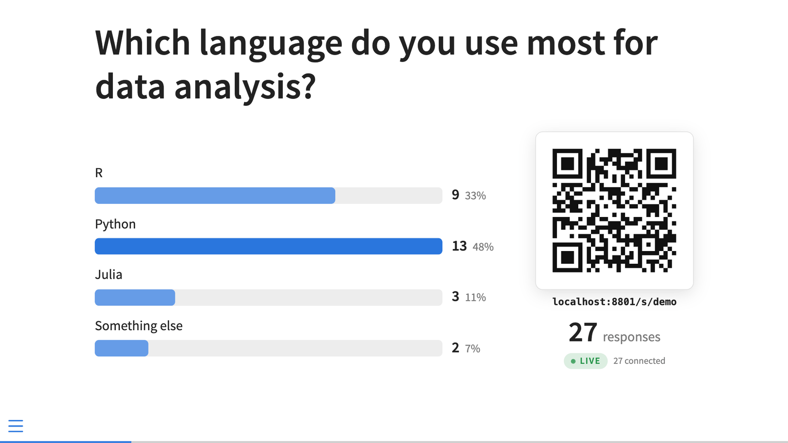
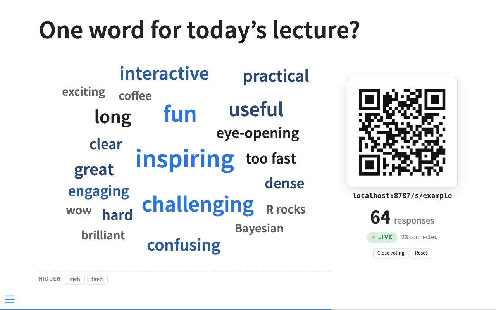

# Live Poll for Quarto revealjs

Live audience polls (bar charts) and word clouds in Quarto revealjs decks.
When you reach a question slide, the question opens, a QR code sends the
audience to a voting page on their phones, and results appear on the slide as
votes arrive. The backend runs on Cloudflare (free plan) or in Docker.



| | |
|---|---|
|  |  |
|  |  |

Behavior and design decisions are in [SPEC.md](SPEC.md); the wire protocol is
[src/shared/protocol.ts](src/shared/protocol.ts).

## Install

```bash
quarto add <github-org>/quarto-live-poll
```

This installs `_extensions/live-poll/` (a Lua filter plus a revealjs plugin).
Check it into version control with your slides.

## Use

```yaml
---
format: revealjs
filters:
  - live-poll
revealjs-plugins:
  - live-poll
live-poll:
  server: https://questions.example.workers.dev   # your deployed server
  session: stats101-2026-10-13                    # one room per talk
---
```

```markdown
## Which language do you use most?

::: {.poll #lang}
- R
- Python
- Julia
:::

## What is the capital of Australia?

::: {.poll #capital}
- [ ] Sydney
- [x] Canberra
- [ ] Melbourne
:::

## One word for today's lecture?

::: {.wordcloud #mood max-words=2}
:::
```

- A plain list is a poll; `[x]` marks the correct answer(s) of a quiz.
- The prompt sent to phones is the slide heading (or text inside the div, or
  `prompt="..."`).
- Give every question an `#id`. Without one, an id is generated from the
  text, and editing the question starts it over with empty results.
- Without `server`, or when printing to PDF, questions render as a plain list.

See [example.qmd](example.qmd) for a full demo deck.

### Options

| `live-poll:` key | Default | |
|---|---|---|
| `server` | none | Server origin. Omit for a static deck. |
| `session` | file name | Room name. A new name starts with empty results. `?session=name` in the deck URL overrides it (handy for rehearsals). |
| `close-on-leave` | `true` | Close voting when you move off the question's slide. |
| `results` | `live` | `hidden` keeps results off the slide until you press `T`. |
| `qr` | `true` | Show the QR code and short URL on question slides. |

Per question: `results=`, `prompt=`, and for word clouds `max-words=` (default
3) and `max-answers=` (default 3). Details in [SPEC.md](SPEC.md#authoring).

## Presenting

The server has one secret, the presenter key. Open your deck once with it:

```
https://you.github.io/slides/lecture.html?presenter=YOUR-KEY
```

The deck remembers the key in this browser (per server), removes it from the
address bar, and takes control: it opens each question as you reach it.
Anyone else who opens the deck, including from a published URL, is a
read-only viewer. `?presenter=` (empty) forgets the key. The speaker view
never opens questions, so its next-slide preview is safe.

| Key | Action |
|---|---|
| `Q` | Full-screen QR code ("everyone scan this") |
| `A` | Reveal the correct answer (also closes voting) |
| `T` | Show or hide results on the current slide |

Hover over a question for **Close / Reopen voting** and **Reset**. In a word
cloud, click a word to hide it; hidden words are listed underneath, and
clicking one brings it back.

## Server

_To be completed by the integrator: deploying to Cloudflare
(`wrangler deploy`, `wrangler secret put PRESENTER_KEY`) and running the
Docker image. See the `justfile` and SPEC.md "Deployment"._

## Development

```bash
bun install
bun run build:deck        # src/deck/*.ts -> _extensions/live-poll/live-poll.js
bun run typecheck
bun test
quarto render example.qmd
```

`_extensions/live-poll/live-poll.js` is a committed build artifact (`quarto add`
installs it as is); rebuild it after changing `src/deck/`.
