# Live Questions for Quarto revealjs

Live audience polls, quizzes, word clouds and rating scales for Quarto revealjs slides,
written in Quarto markdown and backed by a small server you run yourself.

[](https://github.com/seandavi/quarto-revealjs-live-questions/actions/workflows/ci.yml)
[](LICENSE)
[](https://quarto.org)
[](#cloudflare-worker--durable-object)
[](#docker)

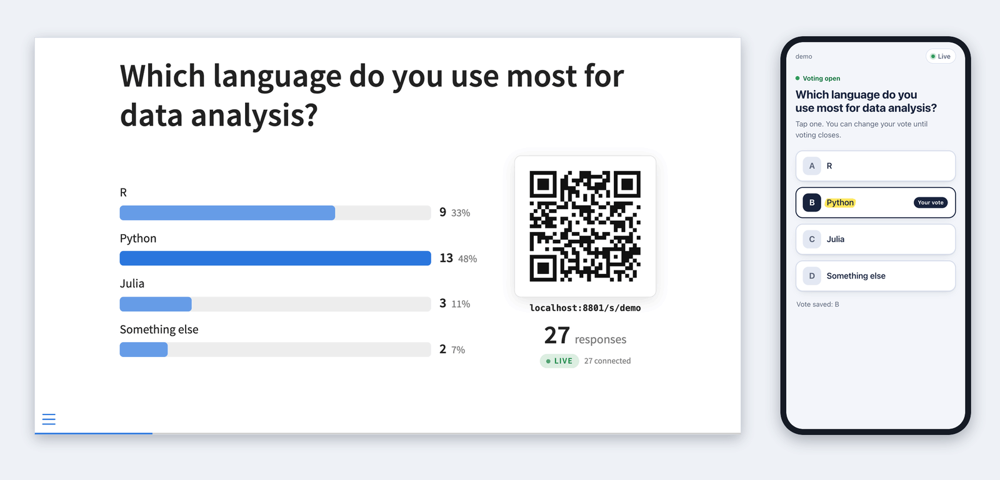

## Why

Asking the room a question is one of the easiest ways to keep a lecture or
talk interactive, but the usual tools live outside your slides: a separate
account, a separate editor, and a copy of the question that drifts from the
deck. Live Questions keeps the question in your `.qmd` file. The same source
renders as a live poll in the browser and as a plain list in a PDF.

## Features

- **Polls and quizzes** from an ordinary bullet list. Mark correct answers
  with task-list syntax (`- [x]`) and reveal them with one key press.
- **Word clouds** from short free-text answers, with per-question limits on
  words and answers, and click-to-hide moderation for the presenter.
- **Rating scales** (Likert): one to six statements on a shared agree/disagree,
  numeric (e.g. 0 to 10) or custom scale, shown as diverging bars or
  histograms.
- **Results on the slide as votes arrive**, or hidden until you show them.
- **One URL per talk.** The QR code points at a session page that follows
  the deck, so the audience scans once and their phones switch to each
  question as you reach it.
- **Phone page** with no app, no login and no third-party requests; light and
  dark themes follow the phone's setting.
- **Presenter control without secrets in the HTML.** A presenter key opens
  questions; everyone else who opens the published deck is a read-only
  viewer.
- **Self-hosted server**: a Cloudflare Worker with one Durable Object per
  session (fits the Workers free plan), or a Docker container. Both run the
  same core code.
- **Static fallback.** Without a server, when printing to PDF, or in
  non-HTML formats, questions render as their original list.

## Quick start

### 1. Install the extension

```bash
quarto add seandavi/quarto-revealjs-live-questions
```

This installs `_extensions/live-questions/` (a Lua filter and a revealjs plugin)
next to your slides. Commit it with them.

### 2. Enable it and write questions

```yaml
---
title: "Week 3"
format: revealjs
filters:
  - live-questions
revealjs-plugins:
  - live-questions
live-questions:
  server: https://live-questions.example.workers.dev   # your server (step 3)
  session: stats101-week3                          # one room per talk
---
```

The extension has to be listed twice, under `filters` and under
`revealjs-plugins`.

```markdown
## Which language do you use most?

::: {.poll #lang}
- R
- Python
- Julia
:::

## One word for today's lecture?

::: {.wordcloud #mood max-words=2}
:::
```

### 3. Run a server

The quickest option is Cloudflare's free plan. You need
[Bun](https://bun.sh), Node.js 22 or later (for Wrangler) and a Cloudflare
account.

```bash
git clone https://github.com/seandavi/quarto-revealjs-live-questions.git
cd quarto-revealjs-live-questions
bun install
bunx wrangler login
openssl rand -hex 24                      # a presenter key; keep it somewhere safe
bunx wrangler secret put PRESENTER_KEY    # paste the key
bunx wrangler deploy                      # prints https://live-questions.<account>.workers.dev
```

Put the printed URL in `live-questions: server:`. To run the server in Docker
instead, see [Running the server](#running-the-server).

### 4. Present

Render or preview the deck, then open it once with your key:

```
https://you.github.io/slides/week3.html?presenter=YOUR-KEY
```

The deck stores the key in this browser, removes it from the address bar and
takes control. As you reach each question slide, the question opens and the
audience can vote.

## Authoring reference

See [example.qmd](example.qmd) for a complete deck.

### Poll

A `.poll` div holding a bullet (or numbered) list. Each item is an option;
inline formatting such as code and emphasis in the labels is kept on the
slide, and phones show the plain text.

```markdown
## Which language do you use most for data analysis?

::: {.poll #lang}
- R
- Python
- Julia
- Something else
:::
```

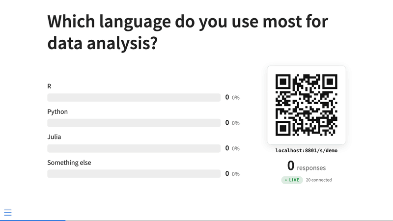

### Quiz

Mark the correct option(s) with task-list checkboxes. A poll with at least one
`[x]` is a quiz. Press `A` during the talk to reveal the answer, which also
closes voting.

```markdown
## What is the capital of Australia?

::: {.poll #capital}
- [ ] Sydney
- [x] Canberra
- [ ] Melbourne
- [ ] Perth
:::
```

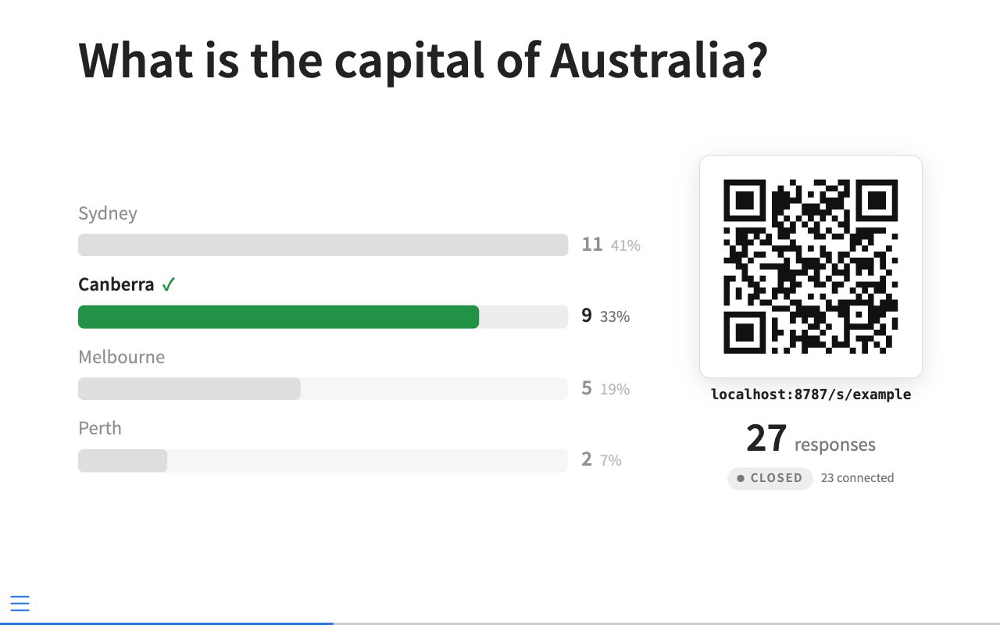

The correct answers are part of the rendered HTML (see
[Privacy and limits](#privacy-and-limits)), but they are never sent to the
server or to phones until you reveal them.

### Word cloud

An empty `.wordcloud` div. Each person can send up to `max-answers` short
answers of up to `max-words` words. Answers are normalized (Unicode, spacing,
surrounding punctuation, case-insensitive matching), and a word's size
reflects how many people gave it.

```markdown
## One word for today's lecture?

::: {.wordcloud #mood max-words=2 max-answers=3}
:::
```

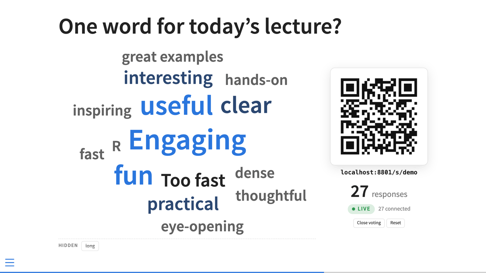

In presenter mode, click a word to hide it from the slide and from phones.
Hidden words are listed under the cloud; click one to bring it back.

### Rating scale (Likert)

In a `.likert` div the list items are *statements*, not options. Everyone
rates every statement on one shared scale:

```markdown
## How did today go?

::: {.likert #feedback scale="agree-5"}
- The pace of today's lecture was right
- The examples helped
- I could follow the live coding
:::
```

| `scale=` | Points |
|---|---|
| `agree-5` (default) | Strongly disagree, Disagree, Neutral, Agree, Strongly agree |
| `agree-7` | adds Somewhat disagree and Somewhat agree |
| `0-10`, `1-5`, ... | numeric, up to 11 points; `low=` and `high=` name the ends |

For any other scale, list the labels from low to high instead of `scale=`:
`labels="Too slow|Just right|Too fast"` (2 to 11 labels). Without a list,
the prompt (or the heading) is the single statement:

```markdown
## How confident are you running a t-test in R?

::: {.likert #confidence scale="0-10" low="Not at all" high="Completely"}
:::
```

Labeled scales show one diverging bar per statement, centered on the neutral
point. Numeric scales show one histogram per statement with the mean and
median. Phones get one row of buttons per statement, and ratings can be
changed until voting closes. There is no correct answer, so `A` does nothing.

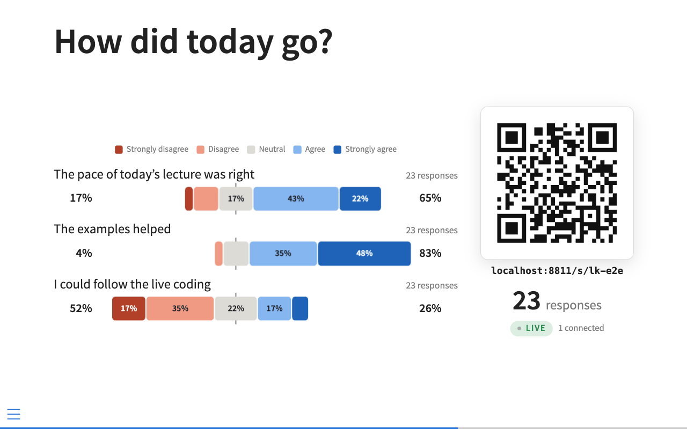

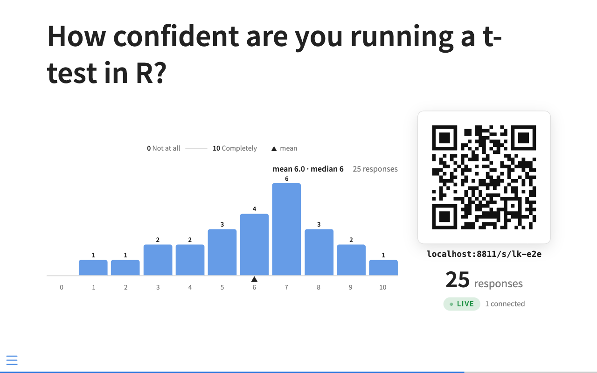

### The prompt

Phones show a prompt for each question. It is, in order: the `prompt="..."`
attribute; any text inside the div other than the list; or the nearest
heading above the question. Text inside the div also appears on the slide:

```markdown
## Before the reveal

::: {.poll #pvalue results="hidden"}
A p-value of 0.03 means:

- [ ] There is a 3% chance the null hypothesis is true
- [x] Data this extreme would occur 3% of the time if the null were true
- [ ] There is a 97% chance the result is real
:::
```

### Question attributes

| Attribute | Applies to | Default | Meaning |
|---|---|---|---|
| `#id` | all | generated from the text | Question id on the server. Give one explicitly: editing a question changes its generated id, and its old results stay behind under the old id. |
| `prompt="..."` | all | see above | The prompt sent to phones. |
| `results=` | all | the `results` option | `live` or `hidden` for this question. |
| `max-words=` | word cloud | 3 | Words kept per answer (1 to 10). |
| `max-answers=` | word cloud | 3 | Answers per person (1 to 10). |
| `scale=` | likert | `agree-5` | `agree-5`, `agree-7`, or a numeric range such as `0-10`. |
| `labels=` | likert | none | Custom scale labels, low to high, separated by `\|`. |
| `low=`, `high=` | likert, numeric | none | Names for the ends of a numeric scale. |

Limits: up to 26 options per poll, 200 characters per option, 500 characters
per prompt, and up to 6 statements and 11 scale points per rating scale. The filter warns at render time about duplicate ids, polls with
fewer than two options and out-of-range values.

### Options

Set these under `live-questions:` in the document front matter or `_quarto.yml`.

| Key | Default | Meaning |
|---|---|---|
| `server` | none | Server origin, e.g. `https://live-questions.example.workers.dev`. Without it the deck renders statically. |
| `session` | input file name | Room name: letters, digits, `-` and `_`, up to 64 characters. A new name starts with empty results. |
| `close-on-leave` | `true` | Close voting when you move off the question's slide. |
| `results` | `live` | `hidden` keeps results off the slide until you press `T` (or reveal the answer). |
| `qr` | `true` | Show the QR code and short URL on question slides. |

Use a new `session` for each talk or class meeting (for example
`stats101-2026-10-13`), or results from last time will still be there when
you reach a question.

## Presenting

### The presenter key

The server has one secret, `PRESENTER_KEY`. Open the deck once with
`?presenter=<key>`:

- The deck stores the key in this browser's `localStorage` (one entry per
  server origin), removes it from the address bar and connects as presenter.
- Later visits from the same browser are presenter automatically.
  `?presenter=` with an empty value forgets the key.
- The key is never written into the rendered HTML, so you can publish the
  deck (GitHub Pages, Quarto Pub, a course site). Anyone else who opens it is
  a viewer: they see the QR code and live results but cannot open, close or
  reset anything.
- A private or incognito window forgets the key when it closes, and a
  different browser or computer needs `?presenter=` again. Do a dry run on
  the machine you will present from.
- Use a key made of URL-safe characters (`openssl rand -hex 24` works).
  `&`, `#` and `%` would need percent-encoding in the URL.
- If the key is wrong, the deck shows "Presenter key not accepted: viewing
  only".

### Modes

| Mode | When | What happens |
|---|---|---|
| static | no `server`, `?print-pdf`, or non-HTML output | Questions show as their list. No QR code, no connection. |
| viewer | `server` set, no key or a wrong key | QR code and live results, no control. |
| presenter | key accepted | Questions open as you reach them; keys and controls below. |
| embedded | inside an iframe, including reveal's speaker view | Viewer, even if a key is stored. |

### What happens as you move through the deck

- Arriving on a question slide opens that question. Only one question is
  live at a time; opening one closes the previous one.
- With `close-on-leave` (the default), leaving the slide closes voting.
  Phones keep showing that question's results until the next one opens.
- Coming back to a question, or reloading the deck, keeps its votes, unless
  you changed the question's text or options, which starts it over.
- If the connection drops, the deck reconnects and puts the server back in
  step with the slide you are on. A question you closed stays closed.

### Keys and controls

| Key | Action |
|---|---|
| `Q` | Full-screen QR code ("everyone scan this"). `Escape`, a click or the next slide closes it. |
| `A` | Reveal the correct answer of the current quiz (also closes voting). Presenter only. |
| `T` | Show or hide results on the current slide. Affects only the deck you press it in. |

The keys appear in reveal's `?` help overlay. Hover over a question (or tab
to it) for **Close voting / Reopen voting** and **Reset**; reset asks for
confirmation.

| `Q` overlay | `results="hidden"` before `T` |
|---|---|
| 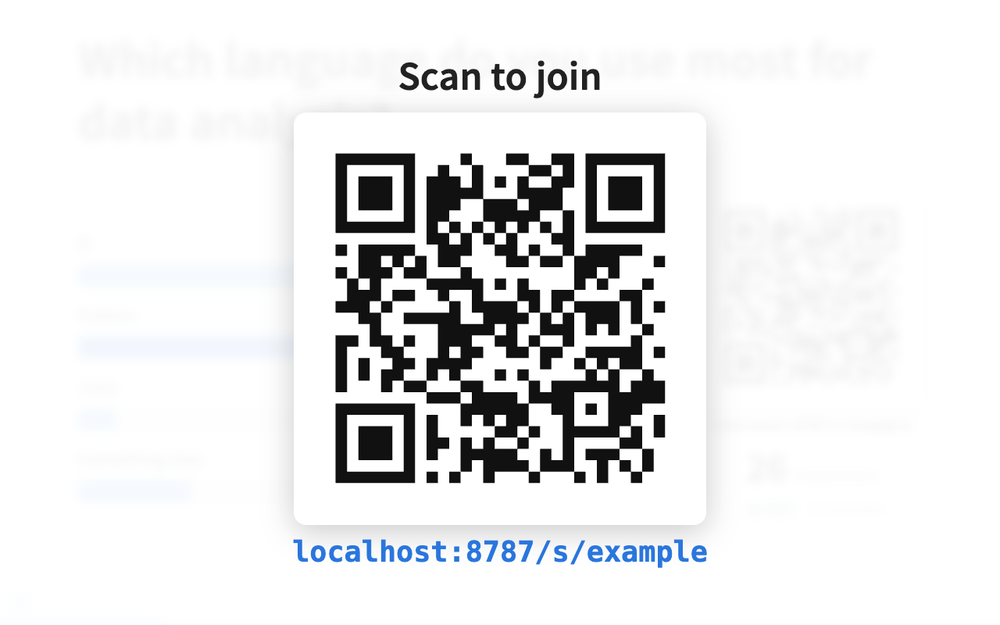 | 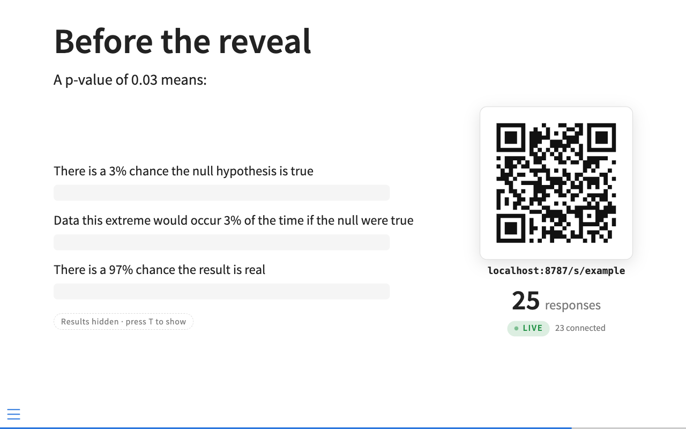 |

### Speaker view

Reveal's speaker view (`S`) shows the current and next slide in iframes.
Those copies always run as viewers, so the next-slide preview never opens
the next question. Present from the main window.

### Rehearsing

Add `?session=<name>` to the deck URL to use a different room without
editing the source, for example `?session=rehearsal` while you practice.
The QR code and the audience URL change with it.

### Themes

The slide components take their colors from the reveal theme, so dark
themes work without extra configuration.

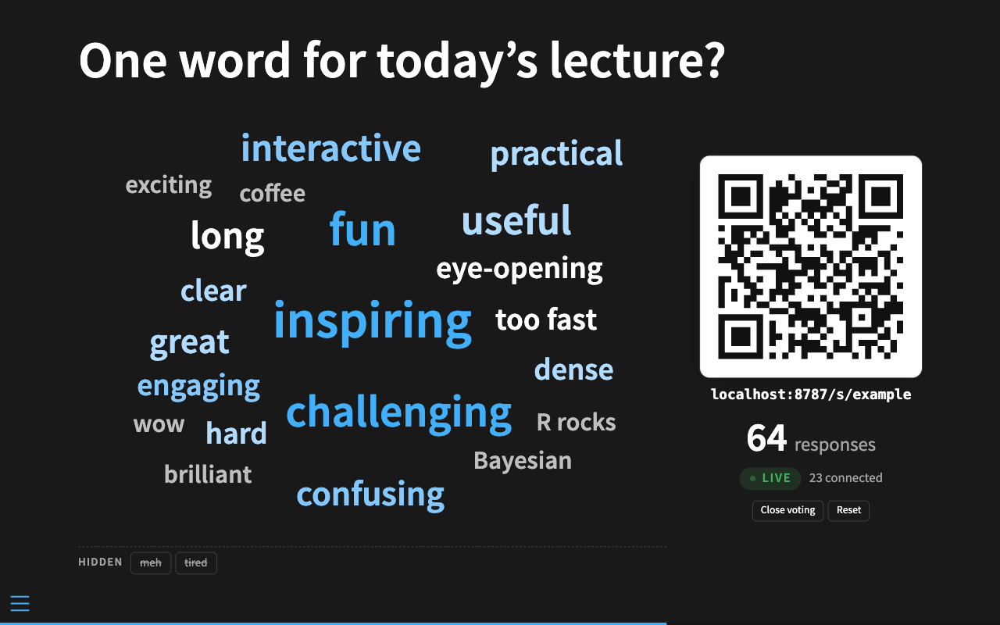

## The audience experience

People scan the QR code (or type the short URL) and get a mobile page for
the session. It follows the deck: when you open a question, every phone
switches to it. While voting is open, phones do not show results, to avoid
bandwagon votes; a person can change their vote until voting closes. After
voting closes, phones show the results, and after a reveal they show which
answer was correct.

| Poll open | Voted | Answer revealed |
|---|---|---|
| 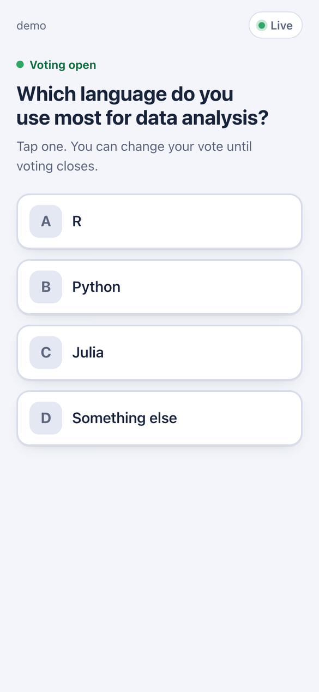 | 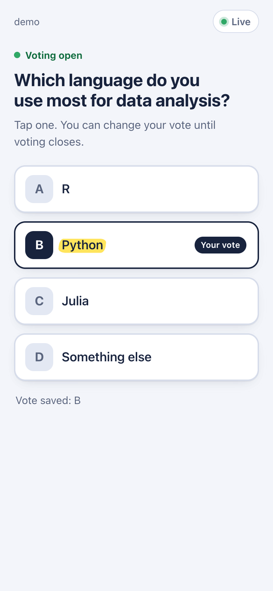 | 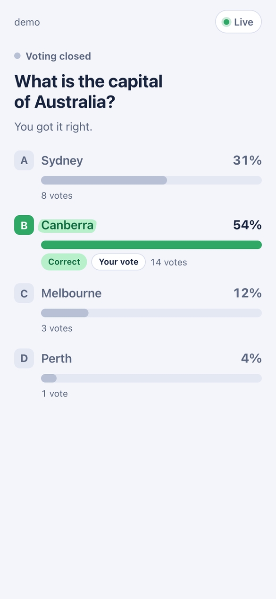 |
| **Word cloud open** | **Word cloud results** | **Dark mode** |
| 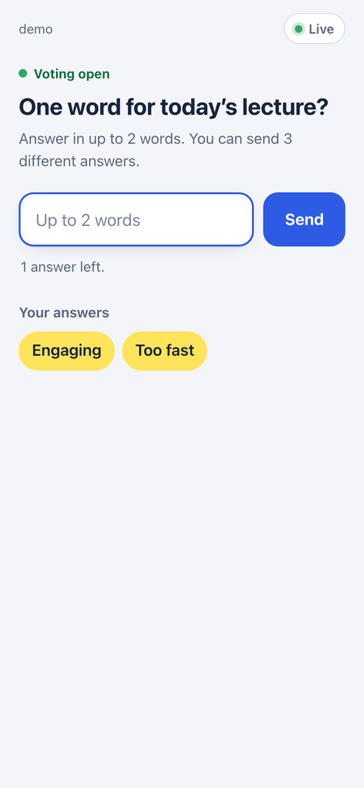 | 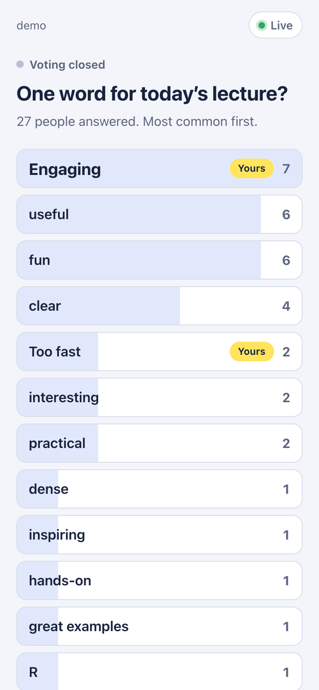 | 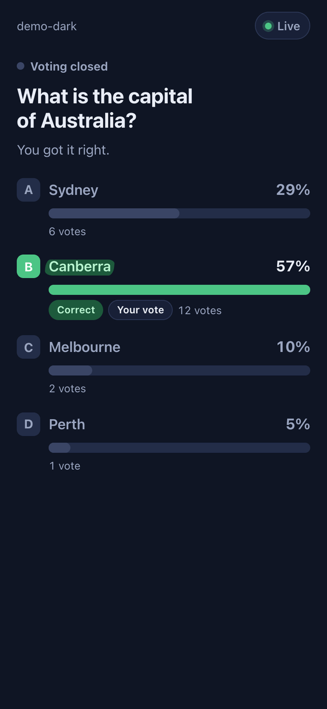 |
| **Rating scale open** | **Numeric scale** | **Rating results** |
| 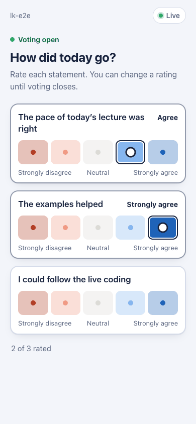 | 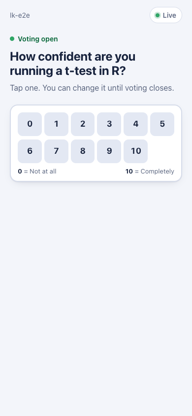 | 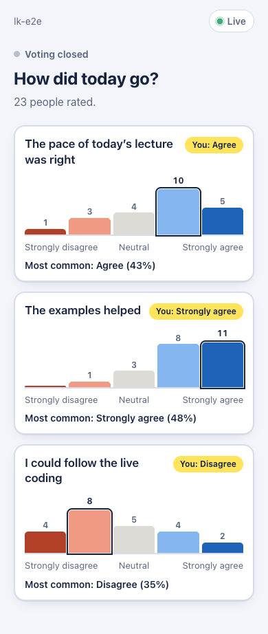 |

The server's root URL shows a form for typing a session name, for people who
cannot scan.

## Running the server

The deck talks to a small server that holds the votes and serves the phone
page. There are two ways to run it; both use the same code, so they behave
the same. Whichever you choose:

- Phones must be able to reach it, so for a real talk give it a public HTTPS
  address. If your deck is served over HTTPS (GitHub Pages, Quarto Pub,
  Netlify), the server must be HTTPS too: browsers block `ws://` connections
  from `https://` pages.
- Pick a long random presenter key. Anyone holding it can run your questions.

### Cloudflare (Worker + Durable Object)

Each session is one Durable Object (SQLite storage), which hibernates while
nobody is sending anything. This fits Cloudflare's Workers free plan.

```bash
bun install
bunx wrangler login
bunx wrangler secret put PRESENTER_KEY
bunx wrangler deploy          # or: just deploy
```

The Worker answers at `https://live-questions.<account>.workers.dev`. To
serve it from your own host name instead, deploy with a custom domain; the
domain's zone must be on the same Cloudflare account, and Cloudflare creates
the DNS record and certificate:

```bash
just deploy live-questions.example.org
# same as: bunx wrangler deploy --domain live-questions.example.org
```

The domain is passed on the command line rather than written into
`wrangler.jsonc`, so a fork of this repository doesn't try to claim yours.

To run it locally, copy `.dev.vars.example` to `.dev.vars` and run
`bunx wrangler dev` (`just dev-cf`).

### Docker

```bash
cp .env.example .env          # set PRESENTER_KEY
docker compose up -d --build
```

The container listens on port 8787, runs as a non-root user and keeps
results in the `live-questions-data` volume, one JSON file per session.
`compose.yaml` includes commented Traefik labels for running it behind a
reverse proxy with TLS. Environment variables:

| Variable | Default | Meaning |
|---|---|---|
| `PRESENTER_KEY` | unset | Presenter secret. Unset means nobody can present (the server logs a warning). |
| `PORT` | `8787` | Listen port. |
| `DATA_DIR` | `/data` | Where session files are written. |

### Local development server

```bash
bun install
just dev-node                 # Node server on http://localhost:8787, key "dev"
```

Set `server: http://localhost:8787` in the deck and open it with
`?presenter=dev`. Phones on the same network need your machine's LAN address
instead of `localhost`.

### Checking a server

```bash
curl https://<server>/healthz                    # prints "ok"
bun scripts/smoke.ts https://<server> <KEY>      # full protocol round trip (or: just smoke)
curl -H "Authorization: Bearer <KEY>" \
  https://<server>/api/s/<session>/export        # every question and result as JSON
```

The smoke test leaves a `smoke-...` session behind on the server.

## How it works

```
presenter deck (Quarto revealjs)               audience phones
 live-questions.lua   markup -> question JSON        /s/<session>  voting page
 live-questions.js    slide change -> open question,      |
                 QR code, live bars / word cloud     | WebSocket
       | WebSocket                                   |
       +------------> one room per session <---------+
                      Cloudflare: Worker + Durable Object (SQLite storage)
                      Docker:     Node + @hono/node-server (built-in WebSockets via ws)
                      both:       Room core (src/server/room.ts) + Hono routes
```

At render time, the Lua filter turns each `.poll` / `.wordcloud` div into a
container carrying the question as JSON, and keeps the original list as the
static fallback. In the browser, the plugin connects to
`<server>/api/s/<session>/ws`, and in presenter mode sends `open` as you reach
each question. The server keeps one room per session: a pure TypeScript
`Room` with all the voting rules, wrapped by a thin adapter for Cloudflare or
Node that handles sockets, authentication, rate limits and storage. Phones
connect to the same room and receive only the live question.

[SPEC.md](SPEC.md) describes the behavior and the design decisions in
detail. The wire protocol is [src/shared/protocol.ts](src/shared/protocol.ts).

## Privacy and limits

**Network connections.** The extension connects only to the `server:` you
configure, over one WebSocket. With no `server:` it makes no network
requests and the deck works fully offline. There is no telemetry, and there
is no default or hosted server: if you don't run one, nothing is sent
anywhere. The QR code library is bundled into `live-questions.js`, so nothing is
loaded from a CDN. The phone page is served by your server and loads nothing
from anywhere else (its Content-Security-Policy allows only its own origin).

**What the server stores**, per session: each question's text and options,
each vote and word-cloud answer keyed by a random voter id, which words the
presenter hid, and which answers were revealed. It does not store names,
accounts or IP addresses. On Cloudflare the data lives in the session's
Durable Object; in Docker, in `$DATA_DIR/<session>.json`. Nothing expires
automatically. To clear a session, use **Reset** on each question or
`bun scripts/presenter.ts <server> <key> <session> reset` for all of them.
`wrangler.jsonc` turns on Workers observability, so Cloudflare also keeps
request logs for your account; remove that setting if you don't want them.

**Known limits**, accepted for classroom and conference use:

- Voter ids are generated by the phone and kept in its `localStorage`.
  Someone can vote again from a private window, another browser or a script.
  The server rate-limits each connection but has no per-person or per-IP
  limit.
- Correct answers for quizzes are in the deck's HTML (`data-lq`). Anyone
  reading the page source can find them before the reveal.
- One presenter key per server, shared by every session on it. There are no
  accounts or per-deck keys; anyone with the key can control any session.
- Results are not shown on phones while voting is open, but anyone with the
  deck URL sees the live results on the slide (unless you use
  `results: hidden`).
- Word-cloud answers are not filtered for profanity. The presenter can hide
  words as they appear.

See [SECURITY.md](SECURITY.md) for reporting vulnerabilities.

## Development

```bash
bun install
just build        # deck bundle, phone page bundle, Node server
just typecheck
just test
just render       # renders example.qmd
```

`_extensions/live-questions/live-questions.js` is a committed build artifact, because
`quarto add` installs it as is. Rebuild it after changing `src/deck/`; CI
fails if it is out of date. [CONTRIBUTING.md](CONTRIBUTING.md) covers the
repository layout, where changes belong, tests and protocol changes. Please
read the [Code of Conduct](CODE_OF_CONDUCT.md) before taking part.

## Prior work and the gap this fills

Live Questions borrows ideas from several projects. Here is how they compare.

- **[rajgoel/reveal.js-plugins](https://github.com/rajgoel/reveal.js-plugins)**
  includes a [poll](https://github.com/rajgoel/reveal.js-plugins/tree/master/poll)
  plugin built on its
  [seminar](https://github.com/rajgoel/reveal.js-plugins/tree/master/seminar)
  plugin. A host opens a seminar room, participants connect to it, and "the
  vote will be sent to the host and the aggregated results are sent to all
  participants." It requires a running socket.io server
  ([rajgoel/seminar](https://github.com/rajgoel/seminar)).
- **[jschildgen/reveal.js-poll-plugin](https://github.com/jschildgen/reveal.js-poll-plugin)**
  is a reveal.js plugin with a mobile voting site and a PHP and SQLite API
  server. Questions are written as HTML in the slides.
- **[Slide Quiz](https://github.com/anycable/slide-quiz)** from Evil
  Martians ([write-up](https://evilmartians.com/chronicles/web-slides-are-web-apps-live-interactivity-for-revealjs-and-slidev))
  adds live quizzes with bar charts and word clouds to reveal.js and Slidev.
  Votes are relayed by AnyCable Plus, a managed WebSocket service, plus three
  small serverless functions on Netlify or Vercel; the authors note that Ably
  or Pusher could take AnyCable's place. In reveal.js, questions are
  `<section>` elements with `data-quiz-*` attributes.
- **Quarto extensions for quizzes** run in the reader's browser and do not
  collect answers from an audience:
  [parmsam/quarto-quiz](https://github.com/parmsam/quarto-quiz) (multiple
  choice questions on revealjs slides with check and reset buttons),
  [parmsam/quarto-flashcards](https://github.com/parmsam/quarto-flashcards),
  [Quarto-Quizkit](https://github.com/beyondsimulations/Quarto-Quizkit)
  ("client-side ... no login, no backend"), and the R package
  [webexercises](https://github.com/PsyTeachR/webexercises).
  [quarto-live](https://github.com/r-wasm/quarto-live) runs R and Python code
  exercises in the browser with WebAssembly. Neither
  [Quarto's extension listing](https://quarto.org/docs/extensions/listing-revealjs.html)
  nor the [community index](https://m.canouil.dev/quarto-extensions/) had an
  audience polling extension when this was written.
- **Self-hostable audience response systems** such as
  [Claper](https://github.com/ClaperCo/Claper) and
  [ClassQuiz](https://github.com/mawoka-myblock/ClassQuiz) are full
  applications with their own editors, separate from your slides.
- **Hosted services**: [Mentimeter](https://www.mentimeter.com),
  [Slido](https://www.slido.com),
  [Poll Everywhere](https://www.polleverywhere.com) and
  [AhaSlides](https://ahaslides.com) are polished hosted products with
  accounts, free tiers and integrations with presentation software such as
  PowerPoint. Questions live in their editors, not in your slide source.

**The gap.** Live Questions is for people who already write slides in Quarto. The
questions, options and correct answers are written in Quarto markdown inside
the slides, and the same source renders as a live poll in revealjs and as a
plain list in a PDF. The server is yours: it runs on the Cloudflare Workers
free plan or in a Docker container, with no third-party pub/sub service in
between. One session URL follows the
deck, so the audience scans once per talk. The presenter key never appears in
the HTML, so the deck you present from can also be the deck you publish.
In return, it does much less than the hosted services: three question types, no
accounts, no results archive, and no protection against a determined person
voting twice.

### Sources

- rajgoel/reveal.js-plugins, poll and seminar READMEs: https://github.com/rajgoel/reveal.js-plugins
- jschildgen/reveal.js-poll-plugin README: https://github.com/jschildgen/reveal.js-poll-plugin
- Evil Martians, "Web slides are web apps: live interactivity for Reveal.js and Slidev" (March 2026): https://evilmartians.com/chronicles/web-slides-are-web-apps-live-interactivity-for-revealjs-and-slidev
- anycable/slide-quiz README: https://github.com/anycable/slide-quiz
- Quarto revealjs extension listing: https://quarto.org/docs/extensions/listing-revealjs.html
- Community Quarto extensions index: https://m.canouil.dev/quarto-extensions/
- Extension READMEs: parmsam/quarto-quiz, parmsam/quarto-flashcards, beyondsimulations/Quarto-Quizkit, PsyTeachR/webexercises, r-wasm/quarto-live (linked above)
- Claper and ClassQuiz READMEs (linked above)
- Vendor sites and plan pages for Mentimeter, Slido, Poll Everywhere and AhaSlides, checked October 2026

## License

[MIT](LICENSE) © 2026 Sean Davis. The deck bundle includes
[qrcode-generator](https://github.com/kazuhikoarase/qrcode-generator)
(MIT, © 2009 Kazuhiko Arase); its notice is in
[`_extensions/live-questions/THIRD_PARTY_NOTICES.md`](_extensions/live-questions/THIRD_PARTY_NOTICES.md).
